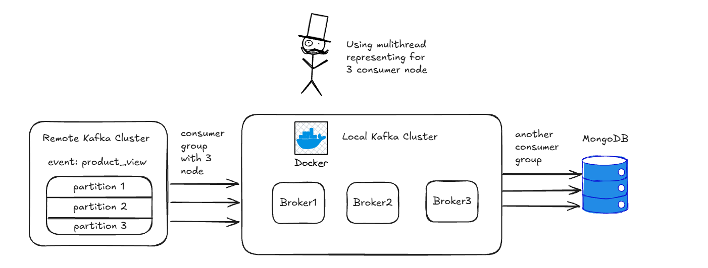

# Remote Kafka → Local Kafka → MongoDB

Pipeline Python đưa dữ liệu từ Kafka cluster remote về Kafka cluster local, sau đó lưu vào MongoDB. Project thực hành cách sử dụng Kafka consumer/producer, xử lý song song bằng consumer group và cải thiện tốc độ bằng batch processing.

Topic đang sử dụng là **`product_view`**. Hai chặng truyền dữ liệu chạy độc lập, mỗi chặng có consumer group riêng và nhiều worker thread.

Các giới hạn về xác nhận gửi, bộ đếm log và xử lý lại dữ liệu được ghi ở phần [Luồng xử lý dữ liệu](#luồng-xử-lý-dữ-liệu). Khi số lượng giữa các hệ thống khác nhau, xem [Lưu dữ liệu và đối soát](#lưu-dữ-liệu-và-đối-soát) trước khi kết luận thiếu message.

## Mục lục

- [Giới thiệu](#giới-thiệu)
- [System architecture](#system-architecture)
- [Cấu trúc thư mục](#cấu-trúc-thư-mục)
- [Cấu hình các component](#cấu-hình-các-component)
- [Cài đặt và chạy](#cài-đặt-và-chạy)
- [Đếm message và partition trên remote Kafka](#đếm-message-và-partition-trên-remote-kafka)
- [Luồng xử lý dữ liệu](#luồng-xử-lý-dữ-liệu)
- [Lưu dữ liệu và đối soát](#lưu-dữ-liệu-và-đối-soát)
- [Lịch sử thay đổi](#lịch-sử-thay-đổi)
- [Insights](#insights)
- [Lời cảm ơn](#lời-cảm-ơn)

## Giới thiệu

Project gồm ba tác vụ chính:

1. **Khảo sát dữ liệu nguồn:** dùng `count_message.py` để liệt kê partition và ước lượng số message còn được lưu trên remote Kafka thông qua offset.
2. **Remote Kafka → Local Kafka:** dùng `remote_to_local_kafka.py` để consume dữ liệu nguồn và produce vào topic local theo batch tối đa 500 message.
3. **Local Kafka → MongoDB:** dùng `local_kafka_to_mongo.py` để consume dữ liệu local, chuyển JSON thành document và ghi vào MongoDB bằng `insert_many()`.


| Thành phần               | Công nghệ                                       |
| -------------------------- | ------------------------------------------------- |
| Ngôn ngữ                 | Python 3.11 trở lên                             |
| Kafka client               | `confluent_kafka`                                 |
| MongoDB client             | `pymongo`                                         |
| Đọc cấu hình           | YAML,`pyyaml`                                     |
| Quản lý dependency       | Poetry                                            |
| Hạ tầng local            | Docker Compose                                    |
| Kafka local                | 3 node, image`confluentinc/cp-kafka:7.6.1`, KRaft |
| MongoDB                    | Image`mongo:8.0`                                  |
| Giao diện quản lý Kafka | AKHQ, image`tchiotludo/akhq:0.24.0`               |

## System architecture



Kafka local làm tầng đệm giữa nguồn remote và MongoDB. Hai script có thể chạy đồng thời: chặng đầu tiếp tục nhận dữ liệu nguồn, còn chặng sau ghi các message đã có ở local vào database.

Các consumer trong hình là worker thread trong ứng dụng Python, không phải broker. Với cấu hình mẫu, mỗi chặng có 3 worker; partition Kafka được đánh số từ `0`, nên topic 3 partition có ID `0, 1, 2`.

## Cấu trúc thư mục

```text
project-01-kafka/
├── config/
│   ├── config.example.yml          # Cấu hình mẫu cho source, destination, mirror
│   ├── config.yml                  # Cấu hình chạy thực tế, tự tạo và được Git ignore
│   └── settings.py                 # Đọc YAML, tạo cấu hình Kafka client
├── docs/
│   ├── kafka-mirror-runbook.md      # Tài liệu của thiết kế mirror trước đây
│   └── kafka-mirror-sample-result.md
├── image/
│   └── system_architecture.png     # Hình kiến trúc hệ thống
├── infra/
│   ├── docker-compose.yml          # Kafka local, AKHQ và MongoDB
│   ├── kafka/
│   │   └── kafka_server_jaas.conf   # Tài khoản SASL/PLAIN của Kafka local
│   └── mongodb/                    # Dữ liệu MongoDB được mount từ container
├── logs/                           # Log/ghi chép local, được Git ignore
├── count_message.py                # Ước lượng số message theo watermark offset
├── remote_to_local_kafka.py         # Chặng remote Kafka → local Kafka
├── local_kafka_to_mongo.py          # Chặng local Kafka → MongoDB
├── monitor_progress.py             # Theo dõi tiến độ mirror trên Windows
├── pyproject.toml                  # Dependency và cấu hình Poetry
├── .gitignore
└── README.md
```

README mô tả các script hiện tại. Các tài liệu trong `docs/` lưu lại thiết kế mirror cũ có transaction/checkpoint và có thể nhắc đến những script không còn trong project.

## Cấu hình các component

### 1. Cấu hình ứng dụng

Tạo file cấu hình từ mẫu tại thư mục gốc project:

```powershell
Copy-Item config/config.example.yml config/config.yml
```

Nếu đã có `config/config.yml`, chỉnh sửa file hiện có. Cấu hình minh họa:

```yaml
source:
  bootstrap_servers: source-broker.example.com:9094
  security_protocol: SASL_PLAINTEXT
  sasl_mechanism: PLAIN
  sasl_jaas_config: ''
  username: source-user
  password: '<remote-password>'

destination:
  bootstrap_servers: localhost:9094,localhost:9194,localhost:9294
  security_protocol: SASL_PLAINTEXT
  sasl_mechanism: PLAIN
  sasl_jaas_config: ''
  username: kafka
  password: '<password-của-user_kafka-trong-JAAS>'

mirror:
  checkpoint_topic: _mirror_product_view_state_v1
  consumer_count: 3
  batch_max_records: 1
```

Các giá trị username/password phải được thay bằng thông tin của từng cluster. Tài khoản local cần khớp với khai báo `user_<username>` trong `infra/kafka/kafka_server_jaas.conf`; tài khoản mẫu trong YAML không tự tạo user trên broker.

File mẫu đặt `batch_max_records: 1`, nhưng hai script truyền dữ liệu hiện vẫn dùng `batch_size = 500` được khai báo trong code.


| Nhóm/trường             | Ý nghĩa và cách sử dụng hiện tại                                                                                        |
| -------------------------- | ------------------------------------------------------------------------------------------------------------------------------- |
| `source`                   | Kết nối remote Kafka, dùng bởi script đếm và chặng remote → local                                                      |
| `destination`              | Kết nối local Kafka, dùng bởi producer chặng đầu và consumer chặng MongoDB                                             |
| `bootstrap_servers`        | Danh sách broker để client lấy metadata cluster                                                                             |
| `security_protocol`        | Giao thức kết nối; cấu hình local hiện dùng`SASL_PLAINTEXT`                                                              |
| `sasl_mechanism`           | Cơ chế xác thực, hiện dùng`PLAIN`                                                                                         |
| `username`, `password`     | Được ánh xạ sang`sasl.username`, `sasl.password` khi dùng SASL                                                            |
| `sasl_jaas_config`         | Trường còn trong schema YAML;`settings.py` không truyền trường này vào Python client                                   |
| `mirror.consumer_count`    | Số worker thread của**mỗi** script truyền dữ liệu                                                                         |
| `mirror.batch_max_records` | Còn trong schema nhưng hai script hiện đặt trực tiếp`batch_size = 500`; đổi YAML chưa làm thay đổi batch thực tế |
| `mirror.checkpoint_topic`  | Còn trong schema nhưng hai script hiện không đọc/ghi checkpoint topic này                                                |

Cần giữ đủ các trường của file mẫu vì `settings.py` dựng các dataclass từ YAML. Cấu hình được đọc từ file, không tự lấy từ biến môi trường.

### 2. Remote Kafka và consumer

Topic `product_view` phải tồn tại trên remote, và máy chạy Python phải truy cập được các broker mà remote trả về trong metadata. Tài khoản cần quyền đọc topic; chặng mirror còn cần quyền sử dụng consumer group tương ứng.

Hai script truyền dữ liệu dùng các thiết lập sau:


| Cấu hình client          | Giá trị                                            | Mục đích                                                               |
| -------------------------- | ---------------------------------------------------- | ------------------------------------------------------------------------- |
| `group.id`                 | `remote_to_local_kafka` hoặc `local_kafka_to_mongo` | Lưu tiến độ riêng cho từng chặng                                   |
| `enable.auto.commit`       | `False`                                              | Script chủ động commit offset                                          |
| `enable.auto.offset.store` | `False`                                              | Script tự xây danh sách offset cần commit                             |
| `allow.auto.create.topics` | `False`                                              | Consumer không yêu cầu tự tạo topic                                  |
| `auto.offset.reset`        | `earliest`                                           | Đọc từ offset sớm nhất còn lưu khi group chưa có offset hợp lệ |

Nếu group đã có committed offset hợp lệ, script tiếp tục từ đó; `earliest` không có nghĩa mỗi lần chạy đều đọc lại từ đầu.

### 3. Local Kafka cluster

File `infra/docker-compose.yml` triển khai ba node Kafka:


| Service   | Node ID | Container  | Địa chỉ từ máy host |
| --------- | ------- | ---------- | ------------------------ |
| `kafka-0` | `0`     | `kafka-00` | `localhost:9094`         |
| `kafka-1` | `1`     | `kafka-01` | `localhost:9194`         |
| `kafka-2` | `2`     | `kafka-02` | `localhost:9294`         |

Mỗi node chạy cả `controller` và `broker` qua `KAFKA_PROCESS_ROLES=controller,broker`. Cluster sử dụng KRaft với quorum voters `0@kafka-0:9093,1@kafka-1:9093,2@kafka-2:9093`, không cần ZooKeeper.


| Listener         | Địa chỉ trong container | Vai trò                                                           |
| ---------------- | -------------------------- | ------------------------------------------------------------------ |
| `CONTROLLER`     | `:9093`                    | Trao đổi trong controller quorum,`PLAINTEXT`                     |
| `INTERNAL`       | `:29092`                   | Giao tiếp giữa các broker,`PLAINTEXT`                           |
| `DOCKER_NETWORK` | `:9092`                    | Client cùng Docker network, như AKHQ, dùng`SASL_PLAINTEXT`      |
| `EXTERNAL`       | `:9094`                    | Client từ máy host qua các cổng publish, dùng`SASL_PLAINTEXT` |

Các node có named volume riêng `broker_data_0`, `broker_data_1`, `broker_data_2`. Compose đặt số partition mặc định cho topic dữ liệu là 3, và replication factor cho các topic nội bộ offset/transaction là 3. Replication factor của topic dữ liệu cần được chọn khi tạo topic; việc có ba broker không tự bảo đảm `product_view` có ba bản sao. Broker đang bật tự tạo topic, còn producer không chỉ định replication factor. Để chọn replication factor mong muốn, tạo topic trước khi chạy producer.

### 4. MongoDB và AKHQ


| Component                    | Cấu hình                                                                               |
| ---------------------------- | ---------------------------------------------------------------------------------------- |
| MongoDB URI                  | `mongodb://localhost:27017`, khai báo trực tiếp trong `local_kafka_to_mongo.py`       |
| Database / collection        | `kafka` / `product_view`                                                                 |
| Dữ liệu đầu vào MongoDB | Mỗi Kafka value phải là JSON object                                                   |
| Ghi dữ liệu                | `collection.insert_many(payloads)` theo batch                                            |
| MongoDB storage              | Bind mount `infra/mongodb/` vào `/data/db`; `docker compose down -v` không xóa thư mục này |
| AKHQ                         | Truy cập[AKHQ local](http://localhost:8180); cấu hình đăng nhập nằm trong Compose |
| AKHQ → Kafka                | Dùng`kafka-0:9092,kafka-1:9092,kafka-2:9092` trong Docker network                       |

## Cài đặt và chạy

### Yêu cầu

- Python 3.11 trở lên và Poetry.
- Docker Engine hoặc Docker Desktop có Docker Compose.
- Kết nối mạng và tài khoản truy cập remote Kafka.

Chạy các lệnh dưới đây tại **thư mục gốc project**. Hai script truyền dữ liệu đọc đường dẫn tương đối `config/config.yml`.

### Bước 1: Cài dependency và chuẩn bị cấu hình

```powershell
poetry install
Copy-Item config/config.example.yml config/config.yml
```

Bỏ qua lệnh sao chép nếu đã có file cấu hình. Điền thông tin remote và thông tin SASL local như phần cấu hình phía trên.

### Bước 2: Khởi động hạ tầng local

```powershell
docker compose -f infra/docker-compose.yml up -d
docker compose -f infra/docker-compose.yml ps
```

Đợi các broker sẵn sàng và MongoDB healthy. Mở AKHQ, đăng nhập bằng tài khoản cấu hình trong Compose, rồi tạo topic local **`product_view`** với **3 partition, replication factor 3** nếu topic chưa tồn tại. Nếu đã có topic, kiểm tra cấu hình hiện có trước khi chạy.

### Bước 3: Khảo sát số liệu nguồn

```powershell
poetry run python count_message.py --topic product_view
```

### Bước 4: Chạy hai chặng ở hai terminal

Terminal 1 — remote Kafka → local Kafka:

```powershell
poetry run python remote_to_local_kafka.py
```

Terminal 2 — local Kafka → MongoDB:

```powershell
poetry run python local_kafka_to_mongo.py
```

Hai script tiếp tục chờ message mới khi hết dữ liệu hiện có. Dùng `Ctrl+C` tại từng terminal để yêu cầu dừng các worker và đóng kết nối. Worker gặp exception sẽ thoát và không được tự khởi động lại; tiến trình chính vẫn có thể chạy nếu còn worker khác sống, nên cần kiểm tra traceback và lag của từng partition.

### Bước 5: Kiểm tra dữ liệu

Kiểm tra topic và consumer group bằng AKHQ. Với MongoDB, mở shell:

```powershell
docker compose -f infra/docker-compose.yml exec mongodb mongosh
```

Chạy trong `mongosh`:

```javascript
use kafka
db.product_view.findOne()
db.product_view.countDocuments({})
```

Script `monitor_progress.py` là công cụ phụ cho Windows, theo dõi committed offset của group remote với partition `0, 1, 2`. Script có thể **tự dừng tiến trình mirror khi gặp lỗi hoặc phát hiện stall**, nên cần đọc hành vi này trước khi dùng. Ngưỡng lag ≤ 50 của script chỉ là tiêu chí theo dõi, chưa phải đối soát toàn bộ dữ liệu.

## Đếm message và partition trên remote Kafka

### Cách chạy `count_message.py`

```powershell
# Mặc định đếm topic product_view trên source
poetry run python count_message.py

# Chỉ định topic và timeout truy vấn
poetry run python count_message.py --topic product_view --timeout 15

# Đếm tất cả topic không bắt đầu bằng __ trên source
poetry run python count_message.py --all-topics

# Dùng file cấu hình khác
poetry run python count_message.py --config config/config.yml --topic product_view

# Ước tính thời gian đọc toàn bộ dữ liệu với throughput đã đo
poetry run python count_message.py --topic product_view --rate 7580.21
```

`--topic` và `--all-topics` là hai lựa chọn loại trừ nhau. `--rate` có đơn vị message/giây, là tốc độ tổng các worker do người chạy cung cấp.

### Thuật toán: `latest_offset - earliest_offset`

Script dùng `source` trong YAML và tạo consumer với group ID `count_message_metadata`, tắt auto commit/auto offset store. Nó chỉ truy vấn metadata và watermark, không `subscribe()`, không consume payload và không tham gia consumer group để chia partition.

1. Gọi `consumer.list_topics()` để lấy metadata và danh sách partition của topic.
2. Với từng partition, gọi `consumer.get_watermark_offsets(..., cached=False)` để lấy `(earliest_offset, latest_offset)`.
3. Lấy hiệu hai offset để ước lượng số message còn lưu ở partition.
4. Cộng kết quả của tất cả partition để ra tổng của topic.

```text
estimate_partition[p] = latest_offset[p] - earliest_offset[p]
estimate_topic        = Σ estimate_partition[p]
```

`earliest_offset` là đầu khoảng offset còn được giữ lại. `latest_offset` là high watermark: **offset cuối + 1**, nên không cộng thêm 1 vào phép trừ. Xem định nghĩa trong [Confluent Consumer API](https://docs.confluent.io/platform/current/clients/confluent-kafka-python/html/index.html#confluent_kafka.Consumer.get_watermark_offsets).

Ví dụ số liệu nguồn được ghi nhận trong phiên ngày 21/10/2026:


| Partition              | Earliest offset | Latest offset | Message ước lượng |
| ---------------------- | --------------: | ------------: | --------------------: |
| 0                      |      32.970.612 |    35.797.850 |             2.827.238 |
| 1                      |      32.971.818 |    35.806.614 |             2.834.796 |
| 2                      |      32.971.149 |    35.790.357 |             2.819.208 |
| **Tổng: 3 partition** |                 |               |         **8.481.242** |

Output có một dòng cho mỗi partition; số dòng partition cho biết số partition của topic. Script hiện không in riêng trường tổng số partition.

Đây là **ước lượng dữ liệu còn lưu**, không phải số message đã xử lý hay backlog của group. Offset gaps do compaction/control records và dữ liệu thay đổi trong lúc truy vấn có thể làm kết quả khác số message thực tế. Không nên lấy riêng `latest_offset` làm số message vì `earliest_offset` có thể đã lớn hơn 0.

Để theo dõi backlog theo offset, cần đối chiếu committed offset của group với latest offset theo từng partition:

```text
lag_partition ≈ latest_offset - committed_offset
```

Nếu truyền `--rate`, script tính `thời gian ≈ tổng message ước lượng / rate`. Đây là thời gian đọc **toàn bộ dữ liệu còn lưu**, giả sử throughput không đổi và không có message mới; không tự trừ phần group đã xử lý.

## Luồng xử lý dữ liệu

### 1. Remote Kafka cluster → Local Kafka cluster

Script: [`remote_to_local_kafka.py`](remote_to_local_kafka.py).

1. Đọc cấu hình, tạo `mirror.consumer_count` worker thread.
2. Mỗi worker có consumer kết nối `source`, cùng group `remote_to_local_kafka`, subscribe topic `product_view`.
3. Kafka phân partition giữa các consumer. Worker lấy tối đa 500 message qua `consume(num_messages=500, timeout=1.0)`; batch có thể ít hơn 500.
4. Kiểm tra lỗi message rồi gọi `producer.produce()` cho từng value vào topic `product_view` ở `destination`.
5. Gom `next_offset = message.offset() + 1` theo từng cặp `(topic, partition)` của **nguồn**.
6. Gọi `producer.flush(timeout=30)` một lần cho batch, rồi commit đồng bộ danh sách source offset bằng `consumer.commit(offsets=..., asynchronous=False)`.
7. In tiến độ và tiếp tục lấy batch mới.

Producer local bật `enable.idempotence=True`, `acks=all`. Script hiện chỉ chuyển **value**; không truyền lại key, headers, timestamp hay chỉ định partition đích. Vì vậy partition và offset ở local không phải bản sao định danh partition/offset nguồn.

**Giới hạn xác nhận gửi hiện tại:** script chưa kiểm tra `remaining` trả về từ `flush()` trước khi commit; biến lỗi callback được dùng chung và chỉ kiểm tra sau commit. Do đó trình tự hiện tại chưa bảo đảm toàn bộ batch đã được local xác nhận trước khi source offset tiến lên. Đây là điểm cần hoàn thiện nếu dùng pipeline với yêu cầu bảo toàn dữ liệu chặt chẽ.

### 2. Local Kafka cluster → MongoDB

Script: [`local_kafka_to_mongo.py`](local_kafka_to_mongo.py).

1. Tạo số worker theo `mirror.consumer_count`.
2. Mỗi worker kết nối Kafka `destination`, cùng group `local_kafka_to_mongo`, subscribe `product_view`.
3. Lấy batch tối đa 500 message và kiểm tra lỗi Kafka.
4. Dùng `json.loads(message.value())` để chuyển từng payload thành Python `dict`. Payload không phải JSON object làm worker báo lỗi.
5. Gom document rồi ghi một lần bằng `mongo_client["kafka"]["product_view"].insert_many(payloads)`.
6. Sau khi lệnh ghi trả về thành công, commit đồng bộ `offset cuối đã xử lý + 1` cho từng partition local trong batch.
7. In tiến độ và tiếp tục xử lý.

Chặng này không dùng Kafka transaction kết hợp MongoDB. Nếu đã ghi database nhưng tiến trình dừng trước commit Kafka, batch có thể được đọc lại; hiện chưa có cơ chế upsert/deduplicate theo Kafka origin. `insert_many()` cũng có thể ghi thành công một phần trước khi gặp lỗi. Vì vậy chưa có bảo đảm exactly-once cho toàn pipeline.

Script giữ nguyên `_id` nếu payload có trường này. Gửi lại document có cùng `_id` sẽ gây lỗi duplicate key; nếu payload không có `_id`, PyMongo tạo `_id` mới và lần đọc lại có thể thêm document trùng nội dung. `insert_many()` hiện dùng mặc định `ordered=True`: gặp lỗi sẽ dừng phần còn lại của batch, exception làm worker thoát và batch đó chưa được commit Kafka. Xem [PyMongo insert operations](https://www.mongodb.com/docs/languages/python/pymongo-driver/current/crud/insert/).

### 3. Đọc log tiến độ

Chặng remote → local có dạng log:

```text
Worker 0 | Batch 500 message | Success message 500 |Tổng đã gửi và commit: 500
```

Chặng local → MongoDB có dạng log:

```text
Worker 0 | Batch 500 message | Tổng đã gửi và commit: 500
```

`Batch N message` lấy từ `len(messages)`, là số message thực tế trong batch. Trường tổng hiện dùng biến đếm tăng cố định 500; riêng chặng MongoDB còn tăng trước khi kiểm tra batch rỗng. Đây là bộ đếm riêng của từng worker, được đặt lại khi worker khởi động.

`Success message` ở chặng đầu được tăng trong delivery callback khi `err is None`; callback được xử lý khi producer được poll/flush. Code còn giữ một đoạn tăng biến dựa trên `delivery["confirmed"]` ngay sau `produce()`, trước `flush()`; đoạn này không xác nhận kết quả của message vừa đưa vào hàng đợi. Bộ đếm callback cũng không khắc phục việc chưa kiểm tra `remaining` và lỗi của cả batch trước commit.

Vì vậy không dùng trường tổng trong log để đối soát số message thành công hoặc benchmark. Nên đo theo committed offset, dữ liệu đích và thời gian thực tế.

## Lưu dữ liệu và đối soát

### Dữ liệu nào còn sau khi khởi động lại Docker?

| Thành phần | Nơi lưu trạng thái | Sau `docker compose -f infra/docker-compose.yml down -v` |
| --- | --- | --- |
| Kafka local | Named volume `broker_data_0/1/2` | Xóa dữ liệu broker, gồm topic local và committed offset của group local |
| MongoDB | Bind mount `./mongodb:/data/db`, tương ứng `infra/mongodb/` | Giữ nguyên document trong thư mục trên host |
| Group `remote_to_local_kafka` | Committed offset trên cluster **remote** | Giữ nguyên; lệnh Compose local không tác động cluster remote |

`up -d` mở lại dữ liệu được giữ trên các mount. Tùy chọn `down -v` xóa named volume khai báo trong Compose và anonymous volume gắn với container, nhưng không xóa thư mục host dùng làm bind mount. Xem [Docker Compose down](https://docs.docker.com/reference/cli/docker/compose/down/).

Với cấu hình hiện tại, xóa volume Kafka local rồi chạy lại có thể tạo ra tình huống: Kafka local bắt đầu rỗng, MongoDB vẫn có dữ liệu cũ, còn consumer nguồn tiếp tục từ committed offset cũ trên remote. `auto.offset.reset=earliest` không tự đọc lại toàn bộ nguồn khi committed offset vẫn hợp lệ. Do đó local có ít message hơn remote không đủ để kết luận mirror chạy chậm; MongoDB nhiều document hơn local cũng chưa chứng minh có ghi trùng.

### Đo backlog và số document

Đối chiếu đúng topic `product_view` và database/collection `kafka.product_view`:

1. Với mỗi cluster, đọc earliest/latest của từng partition để biết khoảng offset còn lưu: `Σ(latest - earliest)`.
2. Với group `remote_to_local_kafka` trên remote và `local_kafka_to_mongo` trên local, đọc committed offset từng partition để tính lag: `Σ(latest - committed)`. Công thức này cần committed offset hợp lệ nằm trong khoảng còn lưu; nếu chưa có hoặc đã ngoài retention, phải xét `auto.offset.reset`.
3. Đọc lag ở ít nhất hai thời điểm để biết backlog đang tăng hay giảm. Tổng message còn lưu ở remote không phải backlog của group.
4. Đếm document thực tế bằng `db.product_view.countDocuments({})`, xét cả dữ liệu từ các phiên chạy trước và lỗi ghi/commit trong log.

Watermark chỉ cho khoảng offset, và các phép đọc xuyên hệ thống không tạo thành một snapshot nguyên tử. Hai chặng không lưu Kafka origin để đối soát từng record, nên việc số lượng bằng nhau chưa chứng minh dữ liệu được chuyển đầy đủ. Muốn đọc lại toàn bộ nguồn sau khi làm mới local cần chủ động chọn group mới hoặc reset group nguồn khi consumer đã dừng, đồng thời có phương án xử lý dữ liệu MongoDB cũ; script hiện không tự thực hiện các bước này.

## Lịch sử thay đổi

### v0.1 — Flush và commit từng message

Luồng xử lý ban đầu:

```text
Consume 1 message → Produce local → Flush → Commit remote → Message tiếp theo
```

Mỗi message phải chờ thao tác gửi và commit đồng bộ, khiến thời gian xử lý lớn khi truyền dữ liệu qua mạng. Ghi chép local tại `logs/2026-10-21-mirror-processing-time.md` lưu kết quả đo trước khi chuyển sang batch: **720 message trong khoảng 40,031 giây**, tương đương **17,99 message/giây** cho tổng các worker.

### v0.2 — Xử lý batch tối đa 500 message

Luồng remote → local được đổi thành:

```text
Consume ≤ 500 message → Produce các message → Flush một lần → Commit theo partition
```

Chặng local → MongoDB cũng gom tối đa 500 message rồi dùng `insert_many()` và commit theo batch. Cách này giảm số lần chờ đồng bộ trên mỗi message, giúp tốc độ tăng đáng kể.


| Chỉ số đo remote → local                 |                 v0.1 |                    v0.2 |
| -------------------------------------------- | -------------------: | ----------------------: |
| Số message tăng ở local trong khoảng đo |                  720 |                 423.188 |
| Thời gian đo                               |        ~40,031 giây |           ~55,828 giây |
| Throughput tổng các worker                 | ~17,99 message/giây | ~7.580,21 message/giây |
| Mức tăng quan sát được                 |                   — |        Khoảng 421 lần |

Các số liệu trên đến từ hai lần đo trong phiên 21/10/2026, dựa trên mức tăng offset local. Đây là kết quả quan sát trong môi trường chạy lúc đó, không phải benchmark kiểm soát cùng mọi điều kiện hay phép xác nhận dữ liệu đã mirror đầy đủ. Thư mục `logs/` được Git ignore nên ghi chép gốc chỉ có trong workspace local.

### v1.0 — Đếm message gửi thành công ở luồng remote → local

Bổ sung biến `success_message` trong `remote_to_local_kafka.py` để đếm số message được Kafka local xác nhận gửi thành công trong từng batch của mỗi worker.

- Đặt `success_message = 0` khi bắt đầu xử lý batch.
- Callback `on_delivery()` dùng `nonlocal success_message` và tăng biến khi `err is None`.
- `producer.flush(timeout=30)` xử lý các delivery callback trong lúc chờ kết quả gửi; log hiển thị số xác nhận thành công ở trường `Success message`.

Ví dụ log của một batch gửi thành công 500 message:

```text
Worker 0 | Batch 500 message | Success message 500 |Tổng đã gửi và commit: 500
```

`Success message` là số xác nhận gửi thành công của batch, còn trường `Tổng đã gửi và commit` vẫn dùng bộ đếm tăng cố định theo `batch_size`. Các giới hạn của logic đếm và kiểm tra kết quả trước commit được mô tả ở phần [Đọc log tiến độ](#3-đọc-log-tiến-độ).

## Insights

### 1. Chi phí truyền qua mạng rất lớn khi xử lý dữ liệu lớn

Thời gian truyền dữ liệu không chỉ phụ thuộc dung lượng và băng thông. Với vòng lặp `produce → flush → commit` từng message, độ trễ chờ phản hồi mạng được lặp lại hàng triệu lần, đặc biệt ở bước commit về cluster remote.

Batch processing phân bổ chi phí chờ cho nhiều message. Batch 500 không có nghĩa toàn bộ xử lý chỉ còn một gói mạng; lợi ích chính trong project là giảm số lần ứng dụng chờ `flush()` và commit đồng bộ.

```text
Throughput tổng ≈ số worker có việc × số message/batch / thời gian xử lý batch mỗi worker
```

Công thức là ước lượng khi tải chia tương đối đều. Tốc độ thực tế còn phụ thuộc kích thước message, mạng, broker, ổ đĩa, replication và tốc độ ghi MongoDB. Batch lớn hơn cũng tăng lượng dữ liệu có thể phải xử lý lại khi dừng trước commit.

### 2. Thao tác cơ bản với Kafka Python API (`confluent_kafka`)


| API                                                | Vai trò trong project                                                        |
| -------------------------------------------------- | ----------------------------------------------------------------------------- |
| `Consumer(config)`                                 | Khởi tạo Kafka consumer                                                     |
| `consumer.list_topics()`                           | Lấy metadata topic/partition                                                 |
| `consumer.get_watermark_offsets()`                 | Đọc earliest/latest offset để ước lượng số message                   |
| `consumer.subscribe([topic])`                      | Đăng ký topic để Kafka phân partition trong group                       |
| `consumer.consume(num_messages=500, timeout=1.0)`  | Lấy batch tối đa 500 message                                               |
| `message.error()` / `message.value()`              | Kiểm tra lỗi / đọc payload                                                |
| `message.partition()` / `message.offset()`         | Lấy vị trí message trong partition                                         |
| `Producer(config)` / `producer.produce()`          | Khởi tạo producer / đưa message vào hàng đợi gửi                     |
| Delivery callback                                  | Nhận kết quả gửi từng message                                            |
| `producer.poll()` / `producer.flush()`             | Phục vụ callback / chờ hàng đợi gửi; project dùng`flush()` theo batch |
| `TopicPartition(topic, partition, next_offset)`    | Biểu diễn offset tiếp theo cần đọc                                      |
| `consumer.commit(offsets=..., asynchronous=False)` | Commit offset đồng bộ                                                      |
| `consumer.close()`                                 | Đóng consumer và rời group                                                |

Offset commit là **vị trí tiếp theo**, nên sau khi xử lý offset `125` cần commit `126`. Nếu batch chứa nhiều partition, phải tính offset riêng cho từng partition. Chi tiết API: [Confluent Kafka Python reference](https://docs.confluent.io/platform/current/clients/confluent-kafka-python/html/index.html).

### 3. Listener, advertised listener, replication factor và role

**Listener và advertised listener.** `listeners` là địa chỉ broker lắng nghe; `advertised.listeners` là địa chỉ broker công bố để client kết nối sau khi lấy metadata. Broker `kafka-1` lắng nghe EXTERNAL tại `:9094` trong container, nhưng publish ra host qua `9194`, nên quảng bá `EXTERNAL://localhost:9194`. Client trên host dùng `localhost`; AKHQ trong Docker dùng hostname service `kafka-0`, `kafka-1`, `kafka-2`. Khi chạy client trên máy khác, phải đổi địa chỉ EXTERNAL sang hostname/IP mà máy đó truy cập được.

**Role trong KRaft.** Broker lưu và phục vụ dữ liệu; controller quản lý metadata và điều phối cluster. Project gộp hai role trên mỗi node; `node.id` phân biệt node, `controller.quorum.voters` xác định quorum.

**Replication factor.** Là số bản sao của mỗi partition. Compose đặt `offsets.topic.replication.factor=3` và `transaction.state.log.replication.factor=3` cho topic nội bộ; `KAFKA_DEFAULT_REPLICATION_FACTOR` đang được comment. Cần kiểm tra replication của `product_view` riêng. `acks=all` chờ các replica đang trong ISR theo cấu hình, không mặc nhiên có nghĩa luôn chờ đủ ba broker. Tham khảo [Apache Kafka broker configuration](https://kafka.apache.org/36/configuration/broker-configs/).

**Partition và consumer group.** Với consumer group thông thường trong project, một partition chỉ được giao cho một consumer trong group tại một thời điểm. Topic có 3 partition thì tối đa 3 consumer trong cùng group có partition để xử lý; tăng thread vượt số này không tự tăng mức song song. Hai chặng có group và cluster riêng nên tiến độ được quản lý độc lập.

**Xác thực và idempotence.** `SASL_PLAINTEXT` xác thực qua SASL nhưng không mã hóa đường truyền bằng TLS. Producer bật idempotence để hạn chế trùng do retry khi gửi; thiết lập này chưa giải quyết việc ứng dụng đọc và gửi lại batch sau restart, cũng chưa khử trùng document MongoDB.

### 4. Thao tác với group.id và hành vi của Docker Compose

**Chạy lại script với cùng group.id.** Kafka lưu committed offset theo group, topic và partition trên cluster mà consumer kết nối. Hai script hiện khai báo `GROUP_ID` trực tiếp trong code. Khi chạy lại với cùng group và committed offset còn hợp lệ, consumer tiếp tục từ vị trí đã commit, thay vì đọc lại từ đầu. Ví dụ: xử lý offset `125` rồi commit `126` thì lần chạy sau bắt đầu từ `126`; phần đã xử lý nhưng chưa commit có thể được đọc lại.

`auto.offset.reset=earliest` chỉ áp dụng khi partition chưa có committed offset hợp lệ. Đổi sang group mới chưa có offset sẽ đọc từ đầu dữ liệu **còn được Kafka lưu**, không khôi phục dữ liệu đã hết retention. Đây là lý do sau khi làm mới Kafka local, chạy lại script với group nguồn cũ không tự tải lại toàn bộ remote. Xem [Confluent Python consumer](https://docs.confluent.io/kafka-clients/python/current/overview.html#kafka-consumer).

**Bind mount của MongoDB.** Compose hiện dùng:

```yaml
volumes:
  - ./mongodb:/data/db
```

Đường dẫn `./mongodb` được tính từ thư mục chứa file Compose, nên ở project này là `infra/mongodb/` trên host. Docker gắn thư mục đó vào `/data/db` trong container:

| Trạng thái thư mục host | Hành vi với cú pháp ngắn ở trên |
| --- | --- |
| Chưa tồn tại | Compose tạo thư mục host rồi mount vào container; không tự sao chép dữ liệu sẵn có từ container ra host |
| Đã tồn tại nhưng rỗng | Container thấy thư mục rỗng tại vị trí mount; MongoDB khởi tạo dữ liệu tại đó |
| Đã có dữ liệu MongoDB | Container thấy dữ liệu host tại `/data/db`; MongoDB mở lại dữ liệu cũ nếu tương thích |

Quy tắc tạo thư mục host được mô tả trong [Compose volumes](https://docs.docker.com/reference/compose-file/services/#volumes).

Bind mount không đổi chiều theo việc thư mục đã tồn tại hay chưa. Sau khi mount với quyền đọc/ghi mặc định, MongoDB ghi vào `/data/db` là ghi vào thư mục host; thay đổi từ host cũng hiển thị trong container. Nội dung có sẵn ở đường dẫn đích trong container bị mount che khuất, không được tự sao chép ra host. Xem [Docker bind mounts](https://docs.docker.com/engine/storage/bind-mounts/).

**Tác động khi chạy lại Docker Compose.** `up -d` dùng lại dữ liệu còn trên mount. `down -v` xóa named volume Kafka local, nhưng không xóa thư mục bind mount MongoDB và không reset group trên remote. Vì vậy có thể gặp trạng thái Kafka local mới, MongoDB còn dữ liệu cũ và consumer nguồn tiếp tục từ offset cũ. Xem bảng trạng thái và cách đối soát ở phần [Lưu dữ liệu và đối soát](#lưu-dữ-liệu-và-đối-soát).

## Lời cảm ơn

Cảm ơn anh **Phương** đã hướng dẫn, chia sẻ kiến thức và kinh nghiệm liên quan đến Kafka trong quá trình thực hiện project.
